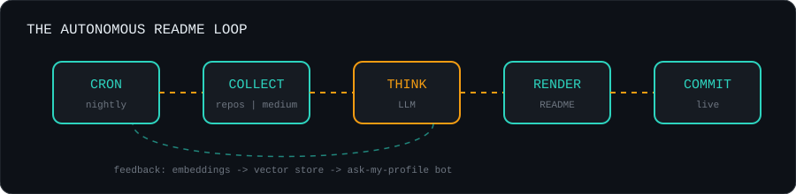

<div align="center">



<br/>

<a href="https://drive.google.com/file/d/1J5cAP8BXB754_pfhR5VGp2jUs1x60KmJ/view?usp=drive_link"></a>
<a href="https://medium.com/@sachanaditya"></a>
<a href="https://www.linkedin.com/in/aditya0024/"></a>
<a href="mailto:sachanaditya207@gmail.com"></a>

<br/><br/>


</div>
<
---

## `> hello_card`

<div align="center">

</div>

---

## `> choose_your_path`

> This profile adapts to who is reading it. Pick one and expand.

<details>
<summary><b>🧑‍💼 I'm a recruiter or hiring manager</b></summary>

<br/>

- **60-second pitch:** Full-stack engineer (Java, Spring Boot, Angular) who now builds multi-agent AI systems.
- **Best proof of work:** Agent Orchestrator (hierarchical multi-agent system) and CrickLive (real-time platform), both in the lab below.
- **Where to look:** [Resume](https://drive.google.com/file/d/1J5cAP8BXB754_pfhR5VGp2jUs1x60KmJ/view?usp=drive_link) | [LinkedIn](https://www.linkedin.com/in/aditya0024/) | [sachanaditya207@gmail.com](mailto:sachanaditya207@gmail.com)

</details>

<details>
<summary><b>🛠️ I'm an engineer who wants to collaborate</b></summary>

<br/>

- I'm exploring: agent orchestration, RAG, tool-calling, distributed systems internals.
- Open to pair on: mini-infra experiments (queues, caches, log-structured stores) and agentic workflow design.
- Open an issue on any repo, or send me a note.

</details>

<details>
<summary><b>🔍 I'm just curious</b></summary>

<br/>

I write something every day on [Medium](https://medium.com/@sachanaditya) and I learn system design by *breaking* things on purpose. Scroll down, and try the Easter egg at the bottom. 🥚

</details>

---

## `> character_sheet`

<div align="center">



</div>

---

## `> the_lab`

| 🧪 Project | ⚙️ What it does | 🧰 Stack | 🏷️ Status |
|---|---|---|---|
| **Agent Orchestrator** | Master + Domain orchestrators routing tasks to email, calendar and meeting agents | Python, LLMs, tool-calling | 🔥 Building |
| **MiniStack** | Mini Redis, queue, Kafka and DB built from scratch, each with a break-it experiment | Python | 🔥 Building |
| **CrickLive** | Real-time cricket scores platform | Spring Boot, Angular, REST | ✅ Shipped |
| **Agrofarm** | Digital marketplace for farmers and customers, with payments | React, MongoDB, Razorpay, Spring Boot | ✅ Shipped |
| **MuseAI** | Audio recognition and song recommendations | TensorFlow, Kotlin, Librosa | ✅ Shipped |
| **Task Manager API** | Secure REST API for task management | Spring Boot, MongoDB, JWT | ✅ Shipped |

<!-- START_SECTION:ai-projects -->
<!-- AI-generated project summaries get injected here -->
<!-- END_SECTION:ai-projects -->

<!-- START_SECTION:ai-idea -->
<!-- AI project idea of the day -->
<!-- END_SECTION:ai-idea -->

---

## `> how_this_readme_works`

<div align="center">

</div>

---

## `> telemetry`

<div align="center">


</div>

---

## `> side_quests`

- [x] Learn system design by breaking things
- [x] Publish daily writing notes
- [ ] Ship the self-updating profile bot
- [ ] Add an "Ask my profile" chat assistant
- [ ] Open-source MiniStack

---

<details>
<summary><code>sudo reveal --secret</code></summary>

<br/>

```text
ACCESS GRANTED.
Secret: the best debugger is a blank page and a clear explanation.
Moral: if you can write the bug down, you are halfway to fixing it.
```

Thanks for reading all the way down. Say hi: [sachanaditya207@gmail.com](mailto:sachanaditya207@gmail.com)

</details>

<div align="center">
<sub>Crafting tech solutions that make a difference.</sub>
</div>
