

<a href="https://github.com/Sachan-aditya"><picture><source media="(prefers-color-scheme: dark)" srcset="assets/dark/intro.svg">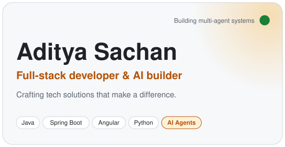</picture></a><a href="https://medium.com/@sachanaditya"><picture><source media="(prefers-color-scheme: dark)" srcset="assets/dark/now.svg">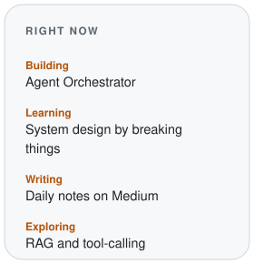</picture></a>
<a href="https://github.com/Sachan-aditya"><picture><source media="(prefers-color-scheme: dark)" srcset="assets/dark/stack.svg">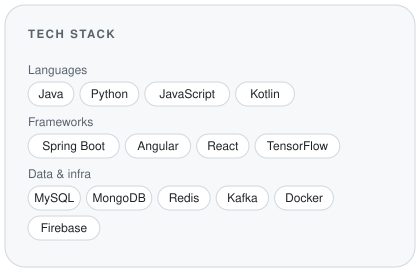</picture></a><a href="https://github.com/Sachan-aditya"><picture><source media="(prefers-color-scheme: dark)" srcset="assets/dark/whatido.svg">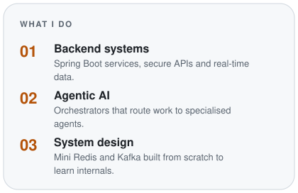</picture></a>

## Projects

<a href="https://github.com/Sachan-aditya?tab=repositories"><picture><source media="(prefers-color-scheme: dark)" srcset="assets/dark/p_cricklive.svg">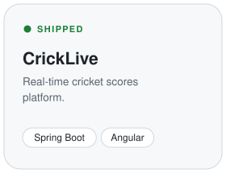</picture></a><a href="https://github.com/Sachan-aditya?tab=repositories"><picture><source media="(prefers-color-scheme: dark)" srcset="assets/dark/p_agrofarm.svg">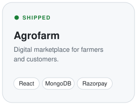</picture></a><a href="https://github.com/Sachan-aditya?tab=repositories"><picture><source media="(prefers-color-scheme: dark)" srcset="assets/dark/p_museai.svg">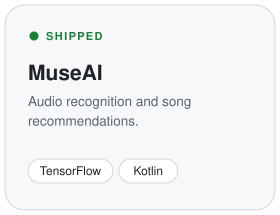</picture></a>
<a href="https://github.com/Sachan-aditya?tab=repositories"><picture><source media="(prefers-color-scheme: dark)" srcset="assets/dark/p_taskapi.svg">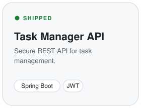</picture></a><a href="https://github.com/Sachan-aditya?tab=repositories"><picture><source media="(prefers-color-scheme: dark)" srcset="assets/dark/p_orchestrator.svg">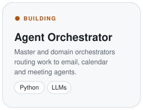</picture></a><a href="https://github.com/Sachan-aditya?tab=repositories"><picture><source media="(prefers-color-scheme: dark)" srcset="assets/dark/p_ministack.svg">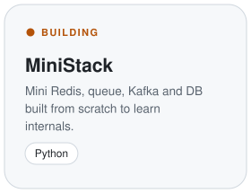</picture></a>

## Writing, resume and contact

<a href="https://medium.com/@sachanaditya"><picture><source media="(prefers-color-scheme: dark)" srcset="assets/dark/writing.svg">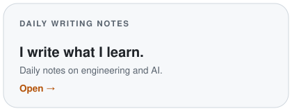</picture></a><a href="https://drive.google.com/file/d/1J5cAP8BXB754_pfhR5VGp2jUs1x60KmJ/view?usp=drive_link"><picture><source media="(prefers-color-scheme: dark)" srcset="assets/dark/resume.svg">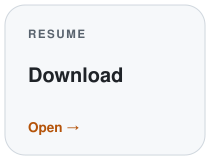</picture></a><a href="mailto:sachanaditya207@gmail.com"><picture><source media="(prefers-color-scheme: dark)" srcset="assets/dark/mail.svg">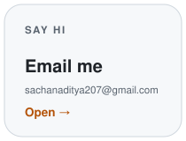</picture></a>

 

## GitHub activity

<picture><source media="(prefers-color-scheme: dark)" srcset="https://github-readme-stats.vercel.app/api?username=Sachan-aditya&show_icons=true&count_private=true&title_color=f5a524&text_color=e6edf3&icon_color=f5a524&bg_color=00000000&hide_border=true"></picture><picture><source media="(prefers-color-scheme: dark)" srcset="https://github-readme-stats.vercel.app/api/top-langs/?username=Sachan-aditya&layout=compact&title_color=f5a524&text_color=e6edf3&icon_color=f5a524&bg_color=00000000&hide_border=true"></picture>

<b>AI project radar</b> (written nightly by an LLM that reads my repos)

 

<!-- START_SECTION:ai-projects -->
| | Project | What it does | The cool part | Stack |
|---|---|---|---|---|
| 🧪 | **[CrickLive](https://github.com/Sachan-aditya/CrickLive)** CrickLive | Real-time cricket scores platform |  | `Java` `TypeScript` |
| 🧪 | **[MuseAI](https://github.com/Sachan-aditya/MuseAI)** MuseAI | Audio recognition & song recommendations |  | `Kotlin` `Python` |
<!-- END_SECTION:ai-projects -->

<!-- START_SECTION:ai-idea -->
> 💡 **Today's AI project idea** (2026-11-26)
>
> **Self-healing README bot**: A bot that notices stale project descriptions and rewrites them.
>
> `Python` `GitHub Actions` `LLM`  
> 🚀 *First step:* Diff each repo's latest commit against its README.
<!-- END_SECTION:ai-idea -->

