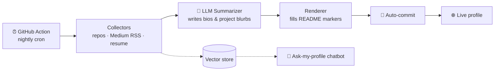

<!-- ═══════════════════════════ HEADER ═══════════════════════════ -->
<div align="center">


<a href="https://github.com/Sachan-aditya">
  
</a>

<br/>


<br/><br/>

<a href="https://drive.google.com/file/d/1J5cAP8BXB754_pfhR5VGp2jUs1x60KmJ/view?usp=drive_link"></a>
<a href="https://medium.com/@sachanaditya"></a>
<a href="https://www.linkedin.com/in/aditya0024/"></a>
<a href="mailto:sachanaditya207@gmail.com"></a>

</div>

<br/>

<!-- ═══════════════════════════ ABOUT ═══════════════════════════ -->
## 👨‍💻 About Me

<table>
<tr>
<td width="60%" valign="top">

```yaml
name:        Aditya Sachan
role:        Full-Stack Developer & AI Engineer
location:    India 🇮🇳
building:    Multi-agent orchestrators & agentic systems
daily_ritual: Writing what I learn on Medium
currently_learning:
  - System design (learning by breaking things)
  - Agentic AI, RAG, tool-calling
  - Distributed systems internals
ask_me_about: [Java, Spring Boot, Angular, Kafka, Redis, AI agents]
motto: "Crafting tech solutions that make a difference."
```

</td>
<td width="40%" valign="top" align="center">


</td>
</tr>
</table>

<!-- ═══════════════════════════ SKILLS ═══════════════════════════ -->
## 🛠️ Tech Arsenal

<div align="center">

**Languages & Frameworks**


**Data, Messaging & Infra**


**Tools & AI**


<br/>


</div>

<!-- ═══════════════════════════ PROJECTS ═══════════════════════════ -->
## 🚀 Featured Projects

<table>
<tr>
<td width="50%" valign="top">

### 🎵 MuseAI
Audio recognition and song recommendations.

`TensorFlow` `Kotlin` `Librosa`

</td>
<td width="50%" valign="top">

### 🏏 CrickLive
Real-time cricket scores platform.

`Spring Boot` `Angular` `REST API`

</td>
</tr>
<tr>
<td width="50%" valign="top">

### 🌾 Agrofarm
Digital marketplace for farmers and customers.

`React` `MongoDB` `Razorpay` `Spring Boot`

</td>
<td width="50%" valign="top">

### ✅ Task Manager API
Secure RESTful API for task management.

`Spring Boot` `MongoDB` `JWT`

</td>
</tr>
<tr>
<td width="50%" valign="top">

### 🧠 Agent Orchestrator
Hierarchical multi-agent system: Master and Domain orchestrators routing to email, calendar and meeting agents.

`Python` `LLMs` `Tool Calling`

</td>
<td width="50%" valign="top">

### 🧱 MiniStack
Learn-by-building system design: mini Redis, queue, Kafka and DB, each with break-it experiments.

`Python` `System Design`

</td>
</tr>
</table>

<!-- START_SECTION:ai-projects -->
<!-- AI-generated project summaries will be injected here by the automation -->
<!-- END_SECTION:ai-projects -->

<!-- ═══════════════════════════ AI SYSTEM ═══════════════════════════ -->
## 🤖 This README Runs Itself

This profile is powered by a small AI pipeline that keeps it fresh without me touching it.



| Stage | What it does | Status |
|-------|--------------|--------|
| Collect | Pulls repos, README files, Medium posts, resume | 🟡 Planned |
| Summarize | LLM writes concise project and article blurbs | 🟡 Planned |
| Render | Replaces marker blocks in this file | 🟡 Planned |
| Chat | RAG assistant answering questions about my work | 🟡 Planned |

<!-- ═══════════════════════════ WRITING ═══════════════════════════ -->
## ✍️ Latest from My Daily Writing Notes

<!-- START_SECTION:blog -->
<!-- Latest Medium posts are auto-populated here -->
Read my notes on **[Medium →](https://medium.com/@sachanaditya)**
<!-- END_SECTION:blog -->

<!-- ═══════════════════════════ STATS ═══════════════════════════ -->
## 📊 GitHub Analytics

<div align="center">


<br/>


<br/>


</div>

<!-- ═══════════════════════════ CONNECT ═══════════════════════════ -->
## 🌐 Let's Connect

<div align="center">

<a href="https://www.linkedin.com/in/aditya0024/"></a>
<a href="https://github.com/Sachan-aditya"></a>
<a href="https://medium.com/@sachanaditya"></a>
<a href="mailto:sachanaditya207@gmail.com"></a>

<br/><br/>

<i>"Crafting tech solutions that make a difference."</i>


</div>
